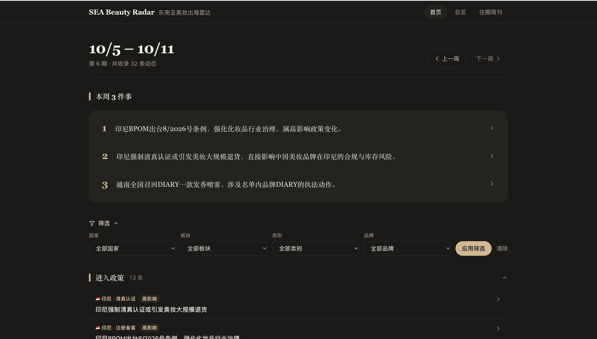
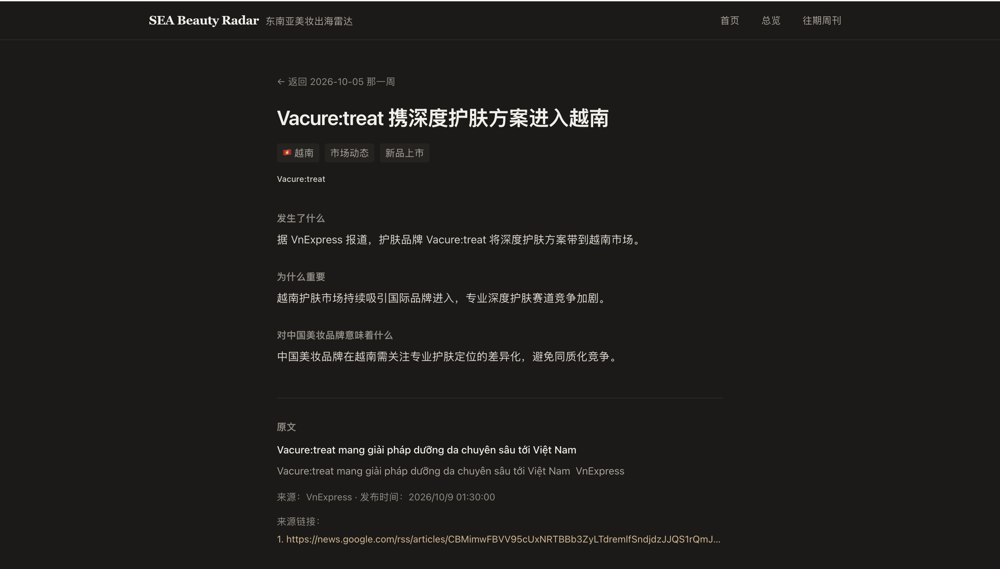
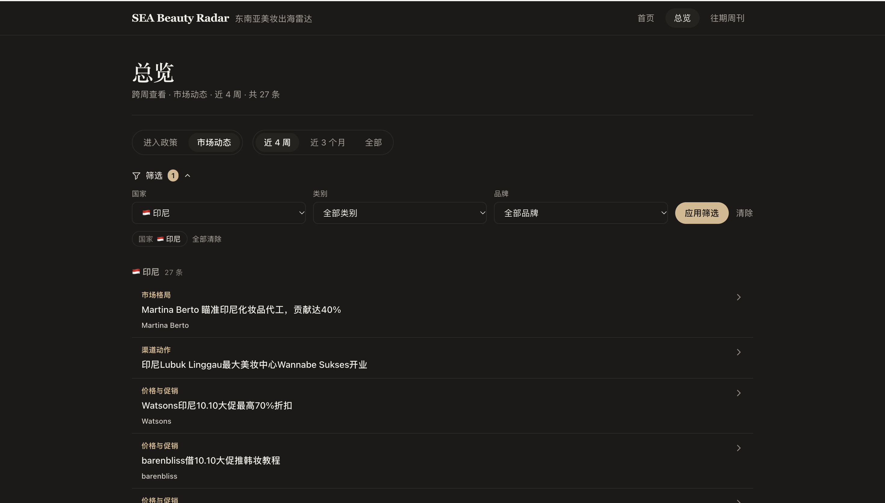
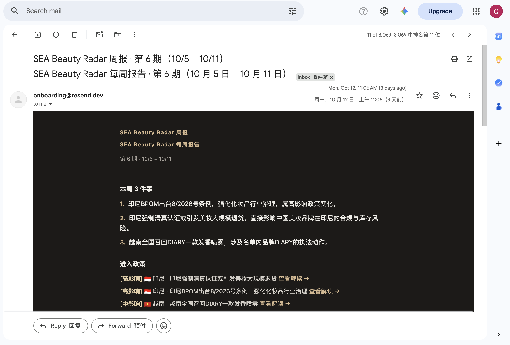

# SEA Beauty Radar — 东南亚美妆出海雷达

SEA Beauty Radar is a weekly automated news radar that tracks competitor moves and policy changes for beauty brands expanding into Southeast Asia. It fetches local-language news across six countries, filters and classifies it with AI, and delivers Chinese-language briefings through a web dashboard and an email newsletter. The whole thing — requirements, design, and code — was built by one person working with Claude Code.

**SEA Beauty Radar 每周自动抓取东南亚 6 国（越南优先）当地语言的美妆新闻，用 AI 筛选、分类并翻译成中文，做成商业情报 Dashboard 和每周邮件周刊。**

🔗 在线演示：<https://sea-beauty-radar.vercel.app>（每周一自动更新）

## 界面截图

| 首页（周视图） | 详情页 |
|---|---|
|  |  |

| 总览（跨周） | 邮件周刊 |
|---|---|
|  |  |

## 解决什么问题

出海美妆团队需要持续、及时地知道东南亚各国「竞品在做什么、政策在怎么变」，但这些信息分散在 6 个国家、多种语言里，靠人工追不过来，也经常发现得太晚。这个工具每周自动把它们抓回来、筛掉无关内容、分好类、翻译成中文、做成三段式解读，然后推送到网页和邮件。

## 核心功能

- **每周自动抓取**：东南亚 6 国（越南优先）当地语言新闻 + 中文出海媒体，只保留上一个完整周。
- **AI 两步分析**：先筛选分类（市场动态 5 类 / 进入政策 6 类，丢掉无关的），再对相关的做三段式解读（发生了什么 / 为什么重要 / 意味着什么）。
- **周视图 Dashboard**：本周 3 件事、进入政策、市场动态；可切换周，可按国家 / 板块 / 类别 / 品牌筛选。
- **配套页面**：跨周总览、单条详情页、往期周刊列表与网页版周刊。
- **每周邮件周刊**：一份一分钟能扫完的中文简报，点「查看解读」跳到详情页。

## 运作流程

```
Google News（6 国当地语言）+ 中文出海媒体
  → 统一格式 + 去重 + 上一个完整周过滤
  → AI 筛选分类（丢掉无关的）
  → AI 三段式解读（只对相关的）
  → 存入 SQLite
  → Dashboard 网页 + 每周邮件周刊
```

每周一早上 8 点（北京时间）由 GitHub Actions 自动跑一遍整条流水线，跑完把新数据提交回仓库，Vercel 检测到 push 自动重新部署。

## 关键设计决定

1. **当地语言一手来源**：用越南语、印尼语等当地语言直接搜 Google News，而不是读英文二手转述，信息更早、更全。
2. **单列「进入政策」**：把各国监管变化（备案、清真认证、平台规则等）单独拎出来追踪——它最枯燥、最少人盯，代价却最高。
3. **按背后资本标注品牌出身**：一些中国资本品牌对外包装成本土或韩系品牌，名单按「背后资本」标注，让用户看清谁才是真正的中国出海品牌。
4. **公开 / 私人名单分离**：公开仓库只放公开可查的品牌名单，直接竞品和自家品牌留在本地私人名单（gitignore），保证公开数据不泄露敏感标签。

## 迭代中发现的问题与修复

- **新增「执法与打假」类别**：测试中同一起打假事件被分进两个不同类别，判断是类别设计有缺口，新增该类别并在合并后统一重分类。
- **政策比例异常排查与回测**：首期政策条目虚高（19 条），排查发现展会、科普、例行执法活动被误判，收紧判定标准后用回测脚本重过历史数据，政策降至 10 条。
- **「运行成功但未产出」的排查与告警**：抓取被限流时返回 0 条却仍显示绿勾，改为检查 HTTP 状态码，失败源超过一半就红叉告警。
- **数据未存回导致回补返工**：SQLite 路径相对 schema 解析，数据写错目录导致每次从空库开始，修正后重新回补 5 周；此后先用单周验证整条链路（包括数据是否真的存下来），再批量处理。

## 技术栈

| 部分 | 选择 |
|---|---|
| 应用 | Next.js 15（App Router）、React 19、Tailwind CSS |
| AI | DeepSeek（默认，可切 Anthropic），结构化 JSON 输出 |
| 存储 | SQLite（Prisma） |
| 邮件 | Resend（没有 key 时只演练、不发送） |
| 定时 | GitHub Actions cron + 手动触发 |
| 部署 | Vercel（免费） |

## 本地运行

```bash
npm install
cp .env.example .env        # 填入 DEEPSEEK_API_KEY 等
npm run db:push             # 创建 SQLite 数据库
npm run seed:demo           # 插入两周示例数据（不需要任何 key）
npm run dev                 # http://localhost:3000
```

没有任何 API key 时，`npm run seed:demo` 会插入两周虚构的示例数据（品牌都是「示例品牌A」这类假名），网页就能完整演示周切换、筛选、详情页和往期周刊。

## 已知局限

- 免费 Vercel 部署在中国大陆访问不稳定（`vercel.app` 可能被墙），面试官在国内时需自备代理。
- 数据源依赖 Google News，对共享 IP 偶发限流，个别周抓取可能不全。
- V1 只抓标题 + 摘要，不抓新闻全文。

## 开发方式

本项目由我（Rue）以产品经理的身份写需求和验收标准，借助 Claude Code 完成开发。需求见 `SPEC.md`、进度与关键决定见 `PROGRESS.md`、设计规范见 `DESIGN.md`。

## 致谢

基于开源项目 [learn-from-github](https://github.com/viviannnl/learn-from-github) 改造。保留了它的整体架构（数据管道 + Dashboard + 周刊 + GitHub Actions 定时运行），把数据源从 GitHub Trending 换成了东南亚美妆新闻。感谢原项目作者。
